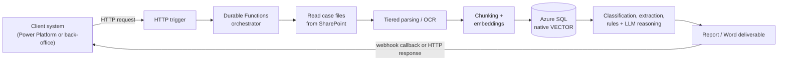

# AI document-analysis platform: case study

Two production engines that read large case files and produce an expert assessment. One assesses eligibility for R&D tax credits, the other analyses subsidized-finance applications. I designed and built both as the sole engineer: analysis, architecture, code, infrastructure as code and CI/CD. A Solution Architect reviewed my pull requests and a PM owned the requirements.

> The codebase belongs to the client and is under NDA, so this repository contains no code. It describes the problem, the architecture and the trade-offs. I'm happy to walk through it in detail in a call.

## Results

- A case file is about **20 documents and 800 pages**: PDFs, scans, TIFFs, digitally signed `.p7m` files and Office documents.
- Assessment time per case went from **more than a week of manual work to 1–2 hours**, about 20 times faster.
- Both engines run in production and are called by the client's systems, not by hand.

## The problem

Consultants used to read every document in a case by hand. For an R&D tax credit they had to decide whether the activities qualify under the OECD Frascati Manual, find the projects, years and costs, and check them against what the tax agency expects. For a subsidized-finance case they had to classify every file, check the requirements and compare the budget tables. The work was slow, repetitive and hard to keep consistent between people.

## Architecture

Both engines share one **config-driven core**. Each engine is mostly configuration on top of it: document types, prompts, rules and output templates.

- **Tax-credit engine:** started through an API with a webhook callback (the caller is Power Platform). The pipeline classifies documents, reads tax-agency metadata and signals, runs an eligibility gate, then extracts projects, years and costs. It consolidates them into a matrix with alerts and a checklist and writes the report. Part of the report is deterministic and part is generated by the LLM.
- **Subsidized-finance engine:** called over HTTP by a client back-office and reads the whole SharePoint folder tree of a case. It classifies documents with embeddings and harmonizes their metadata. Requirement checks are reported as findings and never block the run. It reads the budget tables (initial against final) deterministically, applies business rules and fills a Word template.

## Key decisions

### Cost-aware tiered parsing and OCR

Most pages don't need an expensive OCR model, so each document goes down a ladder and stops at the first tier that gives usable text:

1. **Native parsers in .NET 10:** OpenXml, PDFsharp and LibTiff.NET. Fast and free, and enough for digital documents.
2. **Python tier:** PyMuPDF and pdfplumber for difficult PDFs, RapidOCR on ONNX Runtime for scans.
3. **Mistral OCR on Azure AI Foundry:** only as the final fallback, for pages the other tiers can't read.

This keeps the cost per case low without losing quality on bad scans.

### Deterministic where possible, LLM where needed

Numbers, budget tables and business rules are computed in code, never by the model. The LLM (GPT-5 on Azure AI Foundry) does what code can't: understand free text, judge eligibility against the Frascati criteria and write the narrative parts of the report. This makes the output easier to check and limits the damage of a wrong model answer.

### Vector search in the database we already had

Embeddings live in **Azure SQL with the native `VECTOR` type**, accessed through EF Core 10, instead of a separate vector database. One fewer service to run, secure and pay for, and vectors sit next to the relational data they belong to.

### Durable Functions on Flex Consumption

A case can take a long time to process, so the pipeline runs as a **Durable Functions** orchestration (C# and Python workers) on the **Flex Consumption** plan. It scales to zero between cases and survives long runs, and the tax-credit caller gets the result through a webhook callback instead of keeping a connection open.

## Quality and known limits

- **Document classification:** the first version misclassified most documents. Accuracy improved through repeated rounds of analysis on real cases, refining how each document type is defined and giving the model more context about it. Because the core is config-driven, most fixes were configuration changes, not code changes, and quality keeps improving as new cases come in.
- **Conservative by design:** when a scan is very poor or two documents report conflicting values, the engine can still miss information. In those cases it raises an alert or a finding for the consultant instead of giving a confident answer. A flagged doubt costs a few minutes of review, a confident wrong answer can cost the client the incentive.

## Stack

| Area | Technology |
|---|---|
| Runtime | .NET 10, C#, Python, Azure Durable Functions (Flex Consumption) |
| AI | GPT-5 and Mistral OCR on Azure AI Foundry (Azure.AI.OpenAI), embeddings, RapidOCR on ONNX Runtime |
| Parsing | OpenXml, PDFsharp, LibTiff.NET, PyMuPDF, pdfplumber |
| Data | Azure SQL with native `VECTOR`, EF Core 10, SharePoint |
| Infrastructure | Bicep, Key Vault, Application Insights |
| Delivery | Azure DevOps CI/CD, xUnit |
| Development | Built with Claude Code as an agentic coding tool |

## About me

Antonio Papa, Senior Backend Engineer with 8+ years in C#/.NET on Azure and AWS. [LinkedIn](https://www.linkedin.com/in/antonio-papa) · [GitHub](https://github.com/anachim)
